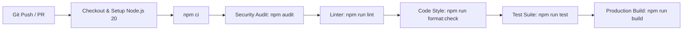

# Dropati Devi Foundation

<div align="center">

[](https://react.dev/)
[](https://vitejs.dev/)
[](https://tailwindcss.com/)
[](https://www.framer.com/motion/)
[](https://vitest.dev/)
[](https://eslint.org/)
[](https://prettier.io/)
[](LICENSE)

<br />

**"A Legacy of Strength. A Future of Possibilities."**

_The official web platform honoring the life, resilience, and compassionate values of Dropati Jethani (1945)._

[About Foundation](#-about-the-foundation) • [Key Features](#-key-features) • [Design System](#-design-system--color-palette) • [Architecture](#-project-structure) • [Tech Stack](#%EF%B8%8F-technology-stack) • [Getting Started](#-getting-started) • [Testing](#-testing--quality-assurance) • [Security & Deployment](#-security-headers--deployment)

</div>

---

## 📖 About the Foundation

The **Dropati Devi Foundation** is a charitable platform inspired by the life journey of **Dropati Jethani (1945)**, whose life exemplified patience, deep faith, courage, and selfless care for others through the upheavals of the 1945 Partition.

Our mission is to dismantle barriers of hardship and empower women, girls, and families across India through four foundational pillars of impact:

- 🎓 **Education & Guidance**: Academic mentorship, digital and literacy support, scholarship access, and learning pathways.
- 🧵 **Vocational Skills**: Practical tailoring, sewing, traditional craftwork, financial literacy, and self-reliance workshops.
- 💼 **Livelihoods & Micro-Enterprise**: Seed equipment, micro-business coaching, and pathways toward financial autonomy.
- 🤝 **Community & Wellbeing**: Safe spaces, health awareness, peer solidarity networks, and family welfare initiatives.

---

## 🌟 Key Features

### 1. Hero & Mission Spotlight

- **Arched Pixel-Reveal Canvas (`ArchedPixelImage`)**: Custom HTML5 canvas and SVG dot matrix visualizer that dynamically renders responsive particle grids and smooth image reveals.
- **Auto-Advancing Visual Carousel**: Touch-friendly, accessible image slides showcasing grassroots schooling, community aid, and celebration.
- **3D Interactive Cube CTA (`CubeButton`)**: Dual-faced 3D perspective button with realistic rotation transitions, auto-cycling preview, and reduced-motion fallback.

### 2. Her Story (Editorial Partition Timeline)

- **Archival Biographical Narrative**: Rich editorial timeline documenting Dropati Devi's early years, her journey through the 1945 Partition, and the enduring values passed through generations.
- **Editorial Typography**: Dignified typographic balance pairing classical serif display styling with ultra-readable body text.

### 3. Cherished Moments Interactive Gallery (`MomentsSection`)

- **Framer Motion Spring Physics**: Dynamic accordion gallery with smooth spring transitions (`stiffness: 160, damping: 30`) that adapts between horizontal desktop panels and vertical mobile cards.
- **Keyboard Navigation & Indicators**: Full support for arrow keys (`ArrowLeft`, `ArrowRight`), active pill progress indicators, and hover triggers.
- **High-Fidelity Captions**: Contextual storytelling celebrating authentic moments of laughter, family unity, and grace.

### 4. Our Purpose (Foundational Pillars)

- **Four Core Pathways**: Dedicated cards for **Learn**, **Earn**, **Thrive**, and **Belong**.
- **Signature Folder-Tab Geometry**: Custom angled tab architecture featuring fine stippled SVG grain noise overlays, subtle gold sheen accents, and ambient radial glows.

### 5. Proposed Programmes Deck (`ScrollStack`)

- **Sticky Scroll Deck Physics**: Hardware-accelerated sticky scroll stacking component where cards dynamically scale, layer, and adjust elevation as the user scrolls.
- **5 Comprehensive Programmes**:
  1. _Vocational Sewing & Crafts_ (Practical Livelihoods)
  2. _Educational Guidance & Access_ (Girls' Education)
  3. _Digital Tools & Micro-Business_ (Women in Business)
  4. _Mentorship & Self-Reliance_ (Confidence & Wellbeing)
  5. _Community Resource Networks_ (Family Solidarity)

### 6. Get Help Cinematic Expander (`ScrollExpand`)

- **Scroll-Driven Expansion**: Interactive viewport that smoothly expands from an initial framed card into a full-bleed assistance module.
- **Direct Support Pathways**: Clear instructions and one-click access for beneficiaries and community members seeking assistance.

### 7. Core Values 3D Flip Showcase (`ValuesSection`)

- **Six Guiding Principles**: _Courage, Compassion, Independence, Service, Family & Community, and Integrity_.
- **3D Perspective Flip Cards**: Interactive dual-sided card geometry with golden borders, preloaded imagery for instant response, and automated preview cycles for non-interactive state.

### 8. Accessible "Register Interest" Modal (`InterestModal`)

- **Dual-Audience Pathways**: Tailored form workflows for both beneficiaries seeking support and volunteers/partners wishing to collaborate.
- **Enterprise Security & Validation**: Input sanitization preventing SMTP header injection, comprehensive regex validation (`validation.js`), and bot honeypot protection (`botcheck`).
- **Web3Forms API Integration**: Transactional email dispatch without requiring server maintenance.
- **Complete A11y Suite**: Modal focus trap, body scroll locking (`useBodyScrollLock`), Escape key listener (`useKeydown`), and screen reader ARIA roles.

### 9. Sticky Glassmorphism Header & Mobile Drawer

- **Scroll-Aware Navbar**: Sticky header featuring progressive backdrop blur, high-contrast navigation links, and integrated 3D CTA.
- **Accessible Slide-Over Drawer**: Responsive mobile drawer with trapped focus, smooth drawer animation, and quick-access contact numbers.

### 10. Robust Fault Isolation (`ErrorBoundary` & Code Splitting)

- **Granular Error Boundaries**: Top-level and section-level error boundaries that isolate unexpected runtime issues without breaking the surrounding layout.
- **React Suspense & Code Splitting**: All below-the-fold sections are dynamically imported with animated skeleton fallback states to guarantee minimal initial bundle size.

---

## 🎨 Design System & Color Palette

The visual identity is anchored by a dignified, high-contrast palette of **Royal Navy Blue** and **Vivid Sun Gold**:

| Token Name          | Hex Code  | Tailwind Utility             | Semantic Purpose                                                    |
| :------------------ | :-------- | :--------------------------- | :------------------------------------------------------------------ |
| **Royal Navy Blue** | `#01236A` | `bg-primary`, `text-primary` | Primary brand color, hero headers, active states, buttons           |
| **Deep Midnight**   | `#001747` | `bg-[#001747]`               | Deep container surfaces, card tab backgrounds, mobile drawer header |
| **Abyssal Blue**    | `#001133` | `bg-[#001133]`               | Darkest gradient stops, folder tab fills, shadow accents            |
| **Vivid Sun Gold**  | `#FFD900` | `bg-gold`, `text-gold`       | Primary accent, CTA buttons, focus rings, interactive highlights    |
| **Pure Bone**       | `#FFFFFF` | `bg-bone`, `bg-white`        | Pristine canvas surface, crisp card backdrops                       |
| **Soft Sand**       | `#F8FAFC` | `bg-sand`                    | Alternating section contrast and subtle background rhythm           |
| **Muted Slate**     | `#475569` | `text-muted`                 | Editorial body typography and secondary metadata                    |
| **Line Border**     | `#E2E8F0` | `border-line`                | Subtle structural dividers and clean card borders                   |

### 🖋️ Typography

- **Display & Headings**: [Playfair Display](https://fonts.google.com/specimen/Playfair+Display) — Elegant, classical editorial serif conveying dignity, heritage, and warmth.
- **Body & UI Elements**: [Plus Jakarta Sans](https://fonts.google.com/specimen/Plus+Jakarta+Sans) — Modern, geometric sans-serif engineered for maximum legibility on screens of all sizes.
- **Labels & Numbers**: [JetBrains Mono](https://fonts.google.com/specimen/JetBrains+Mono) / Font Mono — Crisp numerical identifiers (`01`, `02`) and metadata badges.

---

## 📁 Project Structure

```text
Dropati-Devi/
├── .github/
│   └── workflows/
│       └── ci.yml                 # Automated GitHub Actions CI workflow (Audit, Lint, Format, Test, Build)
├── .husky/                        # Git hooks automation
│   └── pre-commit                 # Pre-commit hook executing lint-staged
├── public/                        # Static assets & SEO metadata
│   ├── .htaccess                  # Apache server security headers & gzip compression
│   ├── .well-known/               # Security discovery (.well-known/security.txt)
│   ├── _headers                   # Cloudflare/Netlify custom security headers
│   ├── favicon.ico                # Multi-resolution favicon
│   ├── apple-touch-icon.png       # Apple iOS home-screen icon
│   ├── logo.webp                  # Foundation high-resolution brand logo
│   ├── robots.txt                 # Search engine bot crawling instructions
│   ├── sitemap.xml                # Canonical search engine sitemap index
│   ├── site.webmanifest           # Progressive Web App manifest
│   └── images/                    # Next-gen WebP photography library
│       ├── hero/                  # Hero carousel imagery
│       ├── moments/               # Cherished moments gallery photos
│       ├── programmes/            # Stacking programme deck photography
│       ├── purpose/               # Purpose pillar imagery
│       ├── sections/              # Section background imagery
│       └── values/                # Core values 3D flip card photography
├── src/
│   ├── components/                # React component architecture
│   │   ├── common/                # Reusable UI atoms and compound components
│   │   │   ├── ArchedPixelImage.jsx # Arched frame with HTML5 canvas pixel-reveal
│   │   │   ├── BrandMark.jsx      # SVG brand identity & typographic logo
│   │   │   ├── CubeButton.jsx     # 3D interactive rotating cube CTA button
│   │   │   ├── ErrorBoundary.jsx  # Enterprise React error boundary with fallback UI
│   │   │   ├── ErrorBoundary.test.jsx # Unit tests for error boundary handling
│   │   │   ├── Eyebrow.jsx        # Uppercase category line label
│   │   │   ├── PurposeCard.jsx    # Custom folder-tab geometry card with noise overlay
│   │   │   ├── ScrollExpand.jsx   # Scroll-driven expanding viewport container
│   │   │   ├── ScrollStack.jsx    # Sticky stacking scroll card deck
│   │   │   └── index.js           # Common components barrel export
│   │   ├── layout/                # Persistent scaffolding components
│   │   │   ├── Navbar.jsx         # Glassmorphism sticky header with mobile drawer
│   │   │   ├── Footer.jsx         # Editorial footer with contact lines and tribute
│   │   │   └── index.js           # Layout barrel export
│   │   ├── modals/                # Accessible overlay dialogs
│   │   │   ├── InterestModal.jsx  # Dual-pathway registration modal with Web3Forms
│   │   │   ├── InterestModal.test.jsx # Modal interaction, validation, and submission tests
│   │   │   └── index.js           # Modals barrel export
│   │   ├── sections/              # Modular landing page sections
│   │   │   ├── HeroSection.jsx    # Hero visual carousel & call to action
│   │   │   ├── StorySection.jsx   # Archival historical biography (1945 Partition)
│   │   │   ├── MomentsSection.jsx # Accordion gallery with spring physics & keyboard controls
│   │   │   ├── PurposeSection.jsx # Four foundational pillars section
│   │   │   ├── ProgrammesSection.jsx # Sticky stacking programme cards
│   │   │   ├── HelpSection.jsx    # Cinematic scroll-expanding help section
│   │   │   ├── ValuesSection.jsx  # 6 core values 3D flip card showcase
│   │   │   ├── InvolvedSection.jsx# Community engagement & partnership pathways
│   │   │   ├── ClosingSection.jsx # Closing tribute banner with Cube CTA
│   │   │   └── index.js           # Sections barrel export
│   │   └── index.js               # Root components barrel export
│   ├── config/                    # Centralized application configuration
│   │   └── index.js               # App config, AOS animation presets, environment helpers
│   ├── constants/                 # Immutable application content & registries
│   │   ├── siteData.js            # Foundation story, moments list, programmes, contact details
│   │   └── index.js               # Constants barrel export
│   ├── hooks/                     # Custom React utility hooks
│   │   ├── useAos.js              # AOS animation lifecycle initializer
│   │   ├── useBodyScrollLock.js   # Scrollbar-width preserving body lock
│   │   ├── useKeydown.js          # Multi-key event listener with cleanup
│   │   ├── useReducedMotion.js    # System `prefers-reduced-motion` detection hook
│   │   ├── useReducedMotion.test.js # Unit tests for reduced-motion detection
│   │   ├── useScrollPosition.js   # RequestAnimationFrame-throttled scroll tracker
│   │   └── index.js               # Hooks barrel export
│   ├── services/                  # External service integrations
│   │   ├── contactService.js      # Web3Forms API client with honeypot & sanitization
│   │   ├── contactService.test.js # Unit tests for API submission and error handling
│   │   └── index.js               # Services barrel export
│   ├── test/                      # Vitest test setup and environment configuration
│   │   └── setup.js               # JSDOM mocks (matchMedia, IntersectionObserver, ResizeObserver)
│   ├── utils/                     # Utility helpers
│   │   ├── cn.js                  # Tailwind class merge utility (`clsx` + `tailwind-merge`)
│   │   ├── validation.js          # Unicode-safe input validation & regex schemas
│   │   └── index.js               # Utils barrel export
│   ├── App.jsx                    # Root application component with code splitting & Suspense
│   ├── index.css                  # Tailwind directives, CSS variables, and utility classes
│   └── main.jsx                   # React 18 DOM mount entry point
├── .editorconfig                  # Consistent cross-editor coding standards
├── .env.example                   # Environment variable template
├── .gitignore                     # Git tracking exclusions
├── .prettierrc                    # Prettier formatting configuration
├── .prettierignore                # Prettier file exclusions
├── eslint.config.js               # ESLint 9 modern flat configuration with a11y rules
├── index.html                     # HTML5 shell with OpenGraph, Twitter Cards & JSON-LD Schema
├── jsconfig.json                  # Path aliases configuration (`@/*` -> `./src/*`)
├── package.json                   # Project dependencies and operational scripts
├── postcss.config.js              # PostCSS plugins (Tailwind CSS, Autoprefixer)
├── tailwind.config.js             # Tailwind CSS theme extensions, palette tokens, animations
├── vercel.json                    # Vercel deployment, rewrites, and HTTP security headers
├── vite.config.js                 # Vite 6 configuration (port 3000, host binding, CSP headers)
└── vitest.config.js               # Vitest configuration (JSDOM environment, alias resolution)
```

---

## 🛠️ Technology Stack

| Category              | Technology                                                                                             | Version               | Purpose                                                          |
| :-------------------- | :----------------------------------------------------------------------------------------------------- | :-------------------- | :--------------------------------------------------------------- |
| **Core Framework**    | [React](https://react.dev/)                                                                            | `^18.3.1`             | Declarative UI, state management, concurrent features            |
| **Build Engine**      | [Vite](https://vitejs.dev/)                                                                            | `^6.1.0`              | Lightning-fast HMR, ES module bundling, tree-shaking             |
| **Styling**           | [Tailwind CSS](https://tailwindcss.com/)                                                               | `^3.4.17`             | Utility-first CSS framework with tailored HSL design tokens      |
| **CSS Processing**    | [PostCSS](https://postcss.org/) & [Autoprefixer](https://github.com/postcss/autoprefixer)              | `^8.5.2` / `^10.4.20` | Automated vendor prefixing and CSS transformation                |
| **Animations**        | [Framer Motion](https://www.framer.com/motion/)                                                        | `^14.1.0`             | Physics-based spring transitions, layout animations              |
| **Scroll Animations** | [AOS (Animate On Scroll)](https://michalsnik.github.io/aos/)                                           | `^2.3.4`              | Viewport-triggered hardware-accelerated animations               |
| **Icons**             | [Lucide React](https://lucide.dev/)                                                                    | `^0.475.0`            | Consistent, accessible, tree-shakeable SVG icons                 |
| **Class Merging**     | [clsx](https://github.com/lukeed/clsx) & [tailwind-merge](https://github.com/dcastil/tailwind-merge)   | `^2.1.1` / `^3.0.1`   | Conflict-free conditional CSS class management                   |
| **Form Submissions**  | [Web3Forms](https://web3forms.com/)                                                                    | API v1                | Serverless transactional form submissions with honeypot security |
| **Testing Framework** | [Vitest](https://vitest.dev/)                                                                          | `^5.0.5`              | Next-generation unit and component testing                       |
| **DOM Testing**       | [Testing Library](https://testing-library.com/)                                                        | `^16.3.3`             | User-centric DOM testing with `@testing-library/jest-dom`        |
| **DOM Environment**   | [JSDOM](https://github.com/jsdom/jsdom)                                                                | `^29.1.1`             | Headless browser DOM emulation for tests                         |
| **Code Linting**      | [ESLint](https://eslint.org/)                                                                          | `^9.39.5`             | Static code analysis with `eslint-plugin-jsx-a11y` & React hooks |
| **Formatting**        | [Prettier](https://prettier.io/)                                                                       | `^3.9.10`             | Opinionated automated code style enforcement                     |
| **Git Hooks**         | [Husky](https://typicode.github.io/husky/) & [lint-staged](https://github.com/lint-staged/lint-staged) | `^9.1.7` / `^17.6.0`  | Automated pre-commit linting and formatting verification         |

---

## 🚀 Getting Started

### Prerequisites

Ensure the following tools are installed in your development environment:

- **Node.js**: `v18.0.0` or higher (recommended: LTS `v20.x`)
- **npm**: `v9.0.0` or higher (or `pnpm` / `yarn`)

### Installation & Local Setup

1. **Clone the repository:**

   ```bash
   git clone https://github.com/digitalwebconnection/Dropati-Devi.git
   cd Dropati-Devi
   ```

2. **Install project dependencies:**

   ```bash
   npm install
   ```

3. **Configure Environment Variables:**
   Duplicate the environment template `.env.example` into a local configuration file:

   ```bash
   cp .env.example .env.local
   ```

   | Variable Name               |    Required     | Default Value                       | Description                                                                                            |
   | :-------------------------- | :-------------: | :---------------------------------- | :----------------------------------------------------------------------------------------------------- |
   | `VITE_WEB3FORMS_ACCESS_KEY` | Optional in dev | _Empty string_                      | Web3Forms Access Key for email delivery. (A fallback development key is included in code for testing). |
   | `VITE_SITE_URL`             |    Optional     | `https://dropatidevifoundation.org` | Canonical production site URL used for meta tags and OpenGraph.                                        |
   | `VITE_APP_TITLE`            |    Optional     | `"Dropati Devi Foundation"`         | Application title displayed in the browser document head.                                              |

4. **Launch the development server:**

   ```bash
   npm run dev
   ```

   The application will start on port `3000` with host listening enabled (`host: true`):
   - **Local Machine**: `http://localhost:3000`
   - **Local Network (Mobile/Tablet testing)**: `http://<your-lan-ip>:3000`

---

## 📜 Available NPM Scripts

| Command                | Action                                                                                       |
| :--------------------- | :------------------------------------------------------------------------------------------- |
| `npm run dev`          | Starts Vite local development server on port `3000` (accessible via localhost & LAN IP)      |
| `npm run build`        | Compiles optimized, code-split production bundle into `/dist` with tree-shaking              |
| `npm run preview`      | Spins up a local static server to preview production build artifacts on port `3000`          |
| `npm run lint`         | Runs ESLint 9 across `src/` to verify code quality, React rules, and accessibility standards |
| `npm run test`         | Runs the Vitest automated test suite once                                                    |
| `npm run test:watch`   | Starts Vitest in interactive watch mode for instant TDD feedback                             |
| `npm run format`       | Auto-formats code across the entire workspace using Prettier                                 |
| `npm run format:check` | Verifies code format compliance without modifying files (used in CI)                         |
| `npm run prepare`      | Configures Husky git hooks                                                                   |

---

## 🧪 Testing & Quality Assurance

The codebase features comprehensive unit and integration testing powered by **Vitest** and **React Testing Library**:

```bash
# Run all automated tests
npm run test

# Run tests in watch mode
npm run test:watch
```

### Test Suite Coverage

- **`ErrorBoundary.test.jsx` (3 tests)**:
  - Catches runtime JavaScript exceptions thrown inside child components.
  - Displays graceful error fallback UI without crashing the application shell.
  - Verifies that custom error handler callbacks (`onError`) receive diagnostic error details.
- **`InterestModal.test.jsx` (8 tests)**:
  - Validates opening and closing lifecycle via trigger buttons and Escape key.
  - Enforces accessible keyboard focus trapping and return focus management.
  - Tests Unicode-safe name, RFC-5322 email, and international phone validation.
  - Confirms honeypot bot mitigation (`botcheck`) quietly rejects automated submissions.
  - Verifies form reset behavior upon closing and reopening.
- **`contactService.test.js` (4 tests)**:
  - Validates payload construction and JSON serialization to Web3Forms API.
  - Tests API error handling and meaningful fallback messaging.
  - Verifies sanitization of single-line fields to prevent SMTP header injection.
  - Validates dev-mode simulation behavior when API keys are absent.
- **`useReducedMotion.test.js` (2 tests)**:
  - Checks compatibility with `(prefers-reduced-motion: reduce)` media query.
  - Tests event listener subscription and state updates when user accessibility preferences change.

### Continuous Integration (CI)

Every commit to `main` and all pull requests are automatically validated by our [GitHub Actions CI Workflow](.github/workflows/ci.yml):



---

## 🔒 Security Headers & Deployment

The platform is optimized for zero-configuration, secure deployment on **Vercel** via [`vercel.json`](vercel.json), with automated SPA routing rewrites and hardened HTTP headers.

### Enterprise Security Headers

Both the development server and production deployment enforce comprehensive HTTP defense-in-depth headers:

- **Content-Security-Policy (CSP)**:
  Restricts script, stylesheet, font, and connection execution strictly to trusted domains (`'self'`, Google Fonts, Unsplash, Web3Forms API).
- **Strict-Transport-Security (HSTS)**:
  `max-age=31536000; includeSubDomains; preload` enforces secure HTTPS connections.
- **X-Content-Type-Options**:
  `nosniff` prevents MIME-type sniffing exploits.
- **X-Frame-Options**:
  `DENY` protects users against clickjacking attacks.
- **Referrer-Policy**:
  `strict-origin-when-cross-origin` preserves user privacy across external navigation.
- **Permissions-Policy**:
  Disables unnecessary hardware APIs (`geolocation=(), microphone=(), camera=(), payment=()`).
- **Cross-Origin-Opener-Policy & Cross-Origin-Resource-Policy**:
  Configured to `same-origin` to isolate browsing context.
- **Immutable Asset Caching**:
  `Cache-Control: public, max-age=31536000, immutable` configured for `/assets/*` and `/images/*` for maximum edge-caching speed.

### Deploying to Vercel

1. Push your repository to GitHub.
2. Import the project in the [Vercel Dashboard](https://vercel.com/new).
3. Set the Framework Preset to **Vite**.
4. Configure environment variables (`VITE_WEB3FORMS_ACCESS_KEY`, `VITE_SITE_URL`).
5. Click **Deploy**.

---

## ♿ Accessibility & Performance Standards

- **WCAG 2.1 AA Compliance**: Color contrasts strictly adhere to contrast ratios of 4.5:1+ for normal body text and 3:1+ for large display headers.
- **Keyboard Navigation & Focus Management**:
  - Direct skip-to-content navigation (`#main-content`) for keyboard and screen reader users.
  - Interactive modals, gallery controls, and buttons provide visible, high-contrast gold focus rings (`focus:ring-2 focus:ring-[#FFD900]`).
  - Native keyboard controls supported throughout (`Tab`, `Shift+Tab`, `Space`, `Enter`, `Escape`, `ArrowLeft`, `ArrowRight`).
- **Reduced Motion Support**:
  All continuous and dynamic animations (AOS scroll reveals, Framer Motion springs, auto-flipping 3D cards) automatically degrade gracefully when `prefers-reduced-motion` is detected in user system settings.
- **Code Splitting & Asset Optimization**:
  - Below-the-fold sections are lazily loaded with React `Suspense`.
  - Next-gen WebP image formats with explicit dimensions minimize layout shift (CLS).
  - Modern ES module chunks built with Rollup tree-shaking for minimal initial download weight.

---

## 📞 Foundation Contact & Support

For program enquiries, volunteer initiatives, or institutional partnerships:

- **Email**: [dropatidevifoundation1945@gmail.com](mailto:dropatidevifoundation1945@gmail.com)
- **Primary Phone**: [+91 95373 92180](tel:+919537392180)
- **Secondary Phone**: [+91 77420 10886](tel:+917742010886)
- **Website**: [https://dropatidevifoundation.org](https://dropatidevifoundation.org)

---

## 📄 License & Attribution

- **Copyright**: © 2026 Dropati Devi Foundation. All rights reserved.
- **Dedication**: Built with eternal gratitude, reverence, and love in memory of **Dropati Jethani (1945)**.
